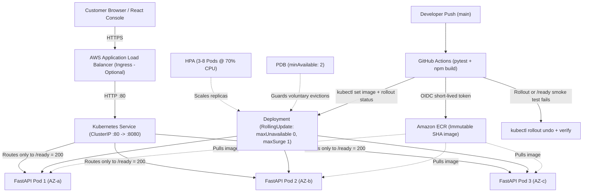

# Solution architecture

## End-to-End AWS Architecture Diagram

## Logical request path
Customer browser → (optional AWS ALB / Ingress) → Kubernetes Service → ready FastAPI Pods → order API.

## Delivery path
Developer commit → GitHub Actions → unit tests → Docker build → Amazon ECR → EKS Deployment image update → rollout validation → optional smoke test → rollback on failure.

## Operations path
FastAPI `/health`, `/ready`, `/version`; Kubernetes probes, Pod/Deployment/Service state, events and logs; CloudWatch integration when provisioned.

## Kubernetes controls
- Deployment: 3 replicas; RollingUpdate; maxUnavailable 0; maxSurge 1; `topologySpreadConstraints` across zones (`topology.kubernetes.io/zone`) and nodes (`kubernetes.io/hostname`).
- Service: ClusterIP, selector `app=retail-order-api`.
- Startup probe: `/health` gives slow-starting containers time to initialize (`SIMULATE_SLOW_START` / `STARTUP_DELAY_SECONDS`).
- Readiness probe: `/ready` removes an unready Pod from Service endpoints without restarting it.
- Liveness probe: `/health` restarts container after repeated failed checks.
- Resource requests/limits: scheduler reservation (`100m`/`128Mi`) and ceiling (`500m`/`256Mi`).
- Security: non-root runtime user, `readOnlyRootFilesystem: true` with `/tmp` `emptyDir`, dropped capabilities.
- PDB: optional voluntary-disruption guard; minAvailable 2.
- HPA: optional CPU target 70%, min 3 max 8; requires metrics API.
- Graceful termination: 30-second termination grace and 5-second `preStop` delay.

## Failure-mode reasoning
Readiness failure: container can remain running but does not receive Service traffic. Liveness failure: kubelet restarts the container. Startup probe: suppresses liveness/readiness until startup succeeds. Failed rollout: deployment may stall; pipeline detects unsuccessful rollout or smoke test and explicitly invokes rollout undo.

## Availability caveats
Three replicas alone do not guarantee multi-AZ placement or node failure tolerance. Confirm worker-node distribution, topology spread/anti-affinity, capacity and autoscaler with the EKS administrator. A Service routes only to ready endpoints but does not create spare capacity. ALB, ECR, IAM/OIDC, CloudWatch, metrics-server and node autoscaling are environment-dependent.
